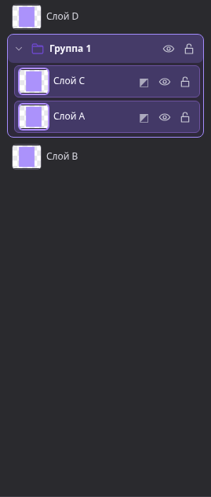
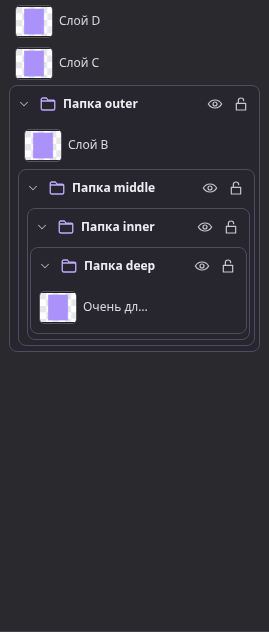
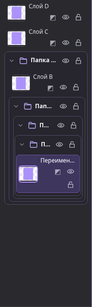
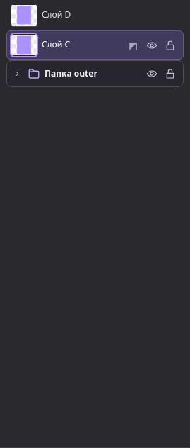
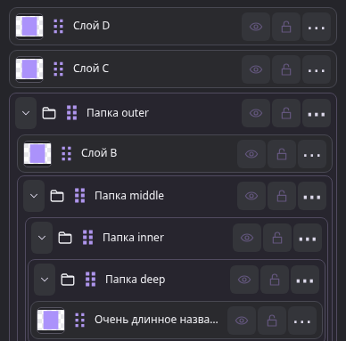
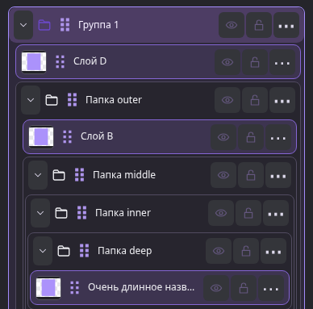
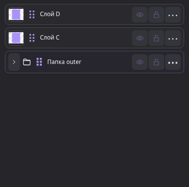

# Несоседние слои и дерево групп

База: `63c5d5777a6acaee0f8eac71c42f2c84ea0ca901` (main после PR #44).

`src/model/group-plan.mjs` рассчитывает операцию без изменения документа.
Выбранные папки нормализуются до корневых выбранных групп; их потомки входят
в перенос один раз. Отдельные выбранные слои должны иметь того же непосредственного
родителя, что и выбранные папки. Проверяются ID, циклы, отсутствующие родители
и непрерывность существующих групп.

Массив хранит элементы снизу вверх. Из него извлекаются выбранные блоки
с сохранением порядка. Точка вставки — число невыбранных элементов до
**верхнего** выбранного включительно. Для `[A,B,C,D]` и выбора A/C результат
`[B,A,C,D]`; дерево показывает D, группу C/A, B. Соседний выбор не меняет порядок.
Меняются только `groupId` непосредственных выбранных слоёв и `parentId`
корневых выбранных папок. Координаты, потомки, маски и ссылки остаются прежними.

Перед применением сравниваются фактические clipping-базы всех clipped-слоёв
по тем же правилам порядка и папки, что использует `findClipBase`.
Целая выбранная цепочка переносится вместе. Если частичный выбор разрывает
цепочку или меняет базу невыбранного слоя, операция отклоняется целиком.
`clipBaseId` не переписывается, clipping не отключается. Legacy-цепочки без
`clipBaseId` и неразрешённые ссылки не исправляются автоматически.
Также запрещена перестановка, меняющая упорядоченный backdrop под `isFxRegion`.

Создание группы вызывает один `commit()`. Выделение хранится как метаданные
снимка истории, отдельно от документа; перед группировкой запоминается исходный
выбор. Общее восстановление снимка возвращает выделение без специальной ветки
Undo для групп. Отклонение не вызывает commit/save. Разгруппирование сохраняет
полученный порядок.

Desktop и mobile используют общий `renderLayerTree`: контейнер папки, строка
заголовка и вложенный контейнер детей. Сохранены `data-sort`, `data-layer`,
`data-group-id` и обработчики перетаскивания. Глубина больше не умножает padding
строк: внутри папки 8 px, начиная с третьего уровня — 2 px плюс тонкие границы.
Удалён пустой слот раскрытия у обычных слоёв.

В узкой desktop-панели (контейнер до 210 px) действия обычного слоя переходят
на вторую строку: даже при минимуме панели 190 px название остаётся читаемым,
миниатюры и кнопки не сжимаются. На обычной ширине строки остаются однострочными.

Контурная папка и chevron — SVG
из существующего `uiIcon`, линия 1.8; промежуток 6 px на desktop и 5 px на mobile.
Chevron отражает `aria-expanded`. Папка/строка выбирает группу, chevron раскрывает
её отдельно. Мобильная кнопка раскрытия имеет область 24×36 px; сохранены
checkbox multi-select, touch-scroll, drag handle и меню действий.

Сознательные ограничения: перенос между разными родителями и автоматическое
добавление невыбранных clipping-зависимостей не выполняются. Небезопасная
комбинация отклоняется с объяснением. Повреждённая иерархия не ремонтируется.
Выбор только пустых папок отклоняется: в модели нет элемента для позиции вставки.
Схема IndexedDB, сохранения, renderer, PWA, OAuth и эффекты не изменены.

Проверки добавлены в `tests/layer-grouping.spec.js` и `tests/group-plan.test.mjs`.
Последний проверяет все 120 выборов из семи слоёв размером не меньше двух,
а также clipping, вложенность и отклонение повреждённых структур.
Скриншоты дерева — артефакты новых тестов; существующие PNG-эталоны не меняются.

## Скриншоты

Обычная группировка A/C, как в референсе:

Четыре уровня вложенности, обычная и узкая панель:

Мобильное дерево до и после группировки, а также свёрнутая папка:

## Локальная проверка окончательной версии

Chromium 154.0.8037.57, Node 24.19.0; версия браузера совпадает с визуальными эталонами.
До production-изменений Playwright подтвердил исходное сообщение о соседстве
и отсутствие группы; trace, screenshot и error context сохранены в `work/reproduction`.

- Целевая регрессия обязательных файлов + mobile: 121/121.
- Новый файл целиком после изменения раскладки узкой панели: 23/23;
  в последующем полном прогоне также прошли усиленные проверки ширины названия,
  фиксированных миниатюр и отсутствия выхода управляющих кнопок за строку.
- Новые unit-проверки: 8/8, включая 120 наборов выбора; связанные unit-файлы: 47/47.
- PNG-пиксели сохранены для целой clipping-цепочки, невыбранной цепочки,
  вложенной цепочки и неизменённого backdrop маскированного `isFxRegion`.
- Проверены один Undo/Redo с восстановлением выделения, инвалидация Redo,
  отсутствие commit/docs.put при отказе, reload/IndexedDB, JSON-импорт/экспорт
  существующей регрессией, копирование/дублирование нового вложенного графа,
  clipping/clipBaseId, маски, boundary-текст, видимость/блокировка, drag и mobile.

Полный цикл выполнен последовательно на окончательной версии, до push:

| Команда | Результат |
| --- | --- |
| `npm run test:unit` | 530 passed |
| `npm run test:source` | 17 passed |
| `npm run test:all` | 345 passed, 2 skipped, 0 failed |
| `npm run test:netlify` | 10 unit passed; 116 browser passed, 1 skipped, 0 failed |
| `npm run build:verify` | passed: неизменные исторические файлы и assets, текущий bundle, детерминированные HTML/ZIP |
| `git diff --check` и `git diff --cached --check` | passed |

Все три пропуска — прежние проверки навигации `file://`, заблокированной
администратором среды: `ERR_BLOCKED_BY_ADMINISTRATOR`, ENV-001. Это два сценария
в `test:all` и один OAuth/file-mode сценарий в Netlify. Новых skip/fixme,
ослабленных assertions, увеличенных таймаутов и изменений эталонов нет.
Производственный код и тесты сверены по контрольным суммам после полного цикла.
Сбойных или необъяснённых тестов в окончательном цикле нет.
Merge и production deploy не выполняются этим PR.
