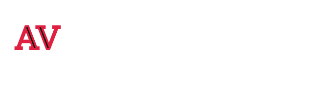
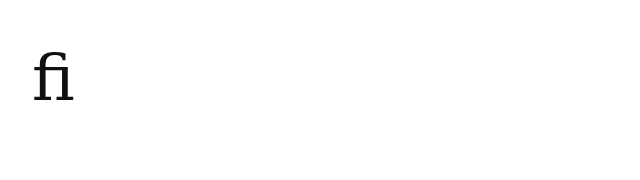
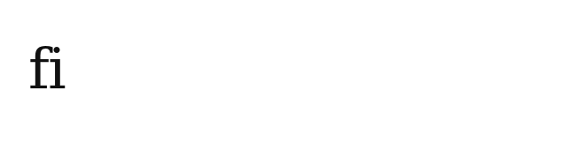

# Issue #115: диапазонная обводка — техническая проверка

Дата: 2026-11-08. База после `git fetch origin main`:
`366223aee2c76dde64f55df39199bbdcedbf1228` (PR #121).
Задача: https://github.com/vadimkorsakov/kartochnaya/issues/115.

**Это исследовательский Draft PR. Обводка диапазонов в рабочем редакторе
не реализована, критерий приёмки #115 не выполнен.** Исходники редактора,
модель, eligibility, сохранение, IndexedDB v3 и существующие PNG-эталоны
не меняются. `strokeWidth`, `stroke`, `strokeStyle`, `strokeOpacity` ещё
не подключены к диапазонному UI/render pipeline.

Работа остановлена на предварительной технической проверке согласно условию
задания: при препятствии, требующем изменения текстового движка, сначала
зафиксировать его и предложить минимальную архитектуру. Проверенные кандидаты
не обеспечивают все требования одновременно. Это не доказательство
невозможности другого небольшого решения.

## Результаты реальных пиксельных измерений

Шрифт — существующий `tests/fixtures/fonts/DejaVuSerif.ttf`, 64 px; DPR 1;
кернинг `normal`; baseline 100 px; координата начала 32 px. Canvas сначала
рисует заливку, затем контур, `lineJoin='round'`, `miterLimit=2`, как `paintText`.
CSS-проекция измеряет фактический DOM baseline нулевым inline marker.
Изображения сравниваются в исходных координатах, без подгонки, смещения,
размытия или масштабирования.

`changed` — число пикселей с любым различием RGB.
`above16` — число пикселей, у которых хотя бы один канал отличается больше
чем на 16 из 255. Это диагностический счётчик, а не допустимый бюджет ошибок.
Полный отчёт содержит максимум ошибки и среднее по объединению областей
чернил, чтобы пустой фон не скрывал дефект.

| Эксперимент | Chromium 154.0.8037.57: changed / above16 | Firefox 157.0: changed / above16 |
| --- | ---: | ---: |
| DOM и Canvas, `AV`, без контура | 0 / 0 | 0 / 0 |
| CSS `-webkit-text-stroke` и Canvas, `AV`, 4 px | 344 / 101 | 0 / 0 |
| CSS и Canvas, `Обводка`, 4 px | 312 / 190 | 0 / 0 |
| Полное `AV` и раздельные `A`, `V` с суммой advance | 733 / 691 | 733 / 690 |
| То же с коррекцией позиции `V` по ширине полного `AV` | 0 / 0 | 0 / 0 |
| Полное `fi` и раздельные `f`, `i` с коррекцией advance | 214 / 133 | 227 / 129 |
| Полный контур `AV`, clip до advance `A`, против контура только `A`, 12 px | 286 / 278 | 286 / 278 |
| То же с дополнительным padding 6 px | 413 / 405 | 413 / 405 |
| DOM fill + sibling Canvas stroke целого `fi`, против Canvas fill+stroke | 0 / 0 | 0 / 0 |
| Скачанный PNG прототипа против его Canvas | 0 / 0 | 0 / 0 |

Полные числа и версии: [measurements.json](evidence/issue-115/measurements.json).
Примеры Chromium:

| CSS, `AV`, 4 px | Canvas, `AV`, 4 px |
| --- | --- |
|  |  |

| Полная лигатура `fi` | Раздельные `f`, `i` после коррекции координат |
| --- | --- |
|  |  |

### Что подтверждено для Canvas-overlay

В изолированном прототипе native keyboard создаёт обратное выделение целого
`fi` в строке `AV fi Жук 😀`: UTF-16 anchor 5, focus 3. Пользовательские
input-события поля толщины меняют её на 8 px, поля цвета — на `#2266dd`.
Отдельный sibling Canvas рисует только stroke; DOM продолжает рисовать fill.
Canvas имеет `pointer-events:none` и находится вне contenteditable.
`innerHTML` редактируемого текста не меняется, направление выделения
восстанавливается после фокуса в полях. Изображение совпадает с полным Canvas
и его настоящей PNG-загрузкой побайтно по RGB в обоих браузерах.

Это подтверждает способ доставки контура и жизнеспособность **целого слова
между пробелами на одной строке**. Это не shipping-editor E2E и не экспорт
через `exportPNG` редактора. В fixture Selection background прозрачен,
каретка скрыта только для измерения чернил. Проверка не доказывает корректность
переносов, смешанных шрифтов, масштабирования, opacity или других масштабов DPR.

### Почему нельзя просто направить stroke в существующие fragments

`rich-text-layout.mjs` уже разделяет геометрические и цветовые ключи:
`geometryKey` сохраняет contextual advance при смене цвета, но отдельные
`fragments` рисуются отдельными `fillText`/`strokeText` в `drawMixedTextGlyphs`.
Если аналогично добавить stroke в paint-key, выделение может создать новую
границу формирования глифов.

В эксперименте коррекция координат действительно возвращает исходный растр
`AV`, но не возвращает лигатуру `fi`: форма единого глифа отличается от суммы
отдельных `f` и `i`. Это не ошибка baseline или общей ширины. Пример специально
включает выбор части лигатуры: требование произвольных выбранных символов шире,
чем успешный опыт с целым словом. Для целого `fi` отдельный `strokeText('fi')`
сохраняет лигатуру.

Другой кандидат — сформировать весь текст и обрезать его контур по диапазону —
проверен на выбранной `A` в `AV` с толщиной 12 px. Прямоугольник по advance
режет нужные чернила и/или включает контур соседа. Padding 6 и 12 px
увеличивает ошибку. Это отклоняет проверенные прямоугольные clipping-кандидаты;
это не доказывает невозможность сложной маски, владеющей отдельными глифами.

CSS не заменяет общий painter с прежней семантикой: хотя Firefox совпал на
всех проверенных образцах, Chromium — нет. У CSS-кандидата также не проверены
эквиваленты Canvas `setLineDash` и stroke-only opacity.

## Минимальная предлагаемая архитектура следующего этапа

1. **Один набор данных.** Расширить `textRuns` и общий style resolver четырьмя
   свойствами с приоритетом override → layer → default. Валидация соответствует
   проектным HEX-цветам, finite width ≥ 0, opacity 0…100, поддерживаемым стилям.
   Явный `strokeWidth:0` должен перекрывать слой. Сначала закрыть нормализацию,
   overlap, insert/delete, историю и восстановление документов unit-тестами.
2. **Геометрия независимо от краски.** Stroke-параметры не участвуют в shaping,
   metrics, wraps, leading, auto-fit или выборе glyph fragments. Существующий
   горизонтальный layout остаётся источником строк и baseline. Для stroke
   нужны отдельные ephemeral paint-операции с исходным UTF-16 интервалом и
   сохранённым контекстом формирования глифов. Они не сериализуются.
3. **Закрыть нерешённое владение контурами.** Общий stroke painter должен
   воспроизводить контуры выбранных глифов, сохраняя форму исходной shaped
   последовательности. Для границ внутри лигатуры необходима явная семантика:
   общий глиф или его визуальная часть. Простого знания grapheme boundaries
   недостаточно: `fi` — два grapheme, но может быть одним глифом. Нужно отдельно
   проверить небольшой adapter с доступом к shaped glyph clusters/outlines либо
   корректную общую маску. В этом PR такой adapter/маска не созданы и их
   совместимость с native metrics не доказана. Добавлять библиотеку shaping
   без этой проверки нельзя: можно нарушить геометрию уже существующих проектов.
4. **Один painter для трёх поверхностей.** После решения пункта 3 использовать
   один stroke painter в Canvas, PNG и sibling overlay WYSIWYG. Динамический
   padding вычислять по ink bounds и stroke, не по прямоугольнику выделения;
   Canvas overlay синхронизировать с zoom, DPR, fonts и размером слоя. Не
   добавлять узлы внутрь contenteditable и не менять существующие проверки
   безопасности сессии. Сначала fill, затем stroke; отдельно проверить U/S.
5. **Инспектор и история.** Перенаправить thickness/color/style/alpha через
   `applyRangeStyle`, включая color picker; при одной каретке потребовать
   выделение, не менять слой. Mixed вычислять по эффективным стилям. Пустой
   ввод — незавершённое редактирование; стрелки начинают с первого символа.
   Preview и final используют существующую групповую историю сессии.

Вариант существенно меньшего объёма — гарантировать только целые слова с
безопасной границей shaping. Он требует изменения объёма задачи и **не
соответствует текущему требованию произвольных символов**, поэтому не внедрён
под видом полного исправления. Сохранение лигатур нельзя просто отключить:
это меняет форму и, возможно, переносы старого текста.

Solid/dashed/dotted и opacity остаются существующими возможностями слоя.
Изолированный опыт подтверждает только solid 100%; новые диапазонные варианты
не реализованы и не имитируются. Общий native Canvas painter потенциально
сохраняет `setLineDash` и alpha, но это ещё требуется измерить на границах.

## Воспроизведение и выполненные проверки

```sh
PLAYWRIGHT_CHROMIUM_EXECUTABLE_PATH=/usr/bin/chromium \
  npx playwright test --config=playwright.spike.config.js range-stroke.spike.js
npm run test:unit
npm run test:source
npm run build
npm run build:verify
git diff --check
```

Результат: 8/8 отдельных браузерных экспериментов, Chromium и Firefox;
580/580 существующих unit-тестов; 17/17 source/build-контрактов;
сборка и `build:verify` успешны. Каждый browser experiment прикладывает
JSON-измерения и исходные PNG через Playwright attachments. Положительный
результат диагностических тестов означает воспроизводимость наблюдений,
**не прохождение feature acceptance**. Тесты не содержат skip/expected failure
и не меняют существующие эталоны.

Новых исходных модулей нет; allowlist `tests/spikes/server.mjs` менять не нужно:
используются уже разрешённые fixture и шрифт. Firefox установлен официальным
Playwright installer. Внутри sandbox Firefox завершался до тестов с
`Could not find profile folder`; разрешённый запуск вне sandbox выполнил оба
браузера без изменения proxy, TLS или browser security settings.

Не выполнены сценарии shipping UI, Mixed, автоподбора, U/S, сохранения в
IndexedDB/JSON, Undo/Redo, повторного открытия и реального `exportPNG`
редактора для новой обводки: самой функции ещё нет. Не выполнен полный
Playwright-регресс продукта, поскольку runtime не менялся. Deploy Preview
не запускался вручную; наличие preview определяется проверками Draft PR.
