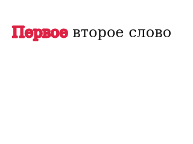
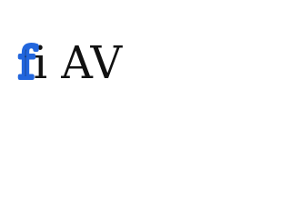

# Диапазонная обводка: реализация и принятая семантика

Issue [#115](https://github.com/vadimkorsakov/kartochnaya/issues/115),
Draft PR [#122](https://github.com/vadimkorsakov/kartochnaya/pull/122).
Проверенная база: `366223aee2c76dde64f55df39199bbdcedbf1228` после повторного
`git fetch origin main`. Рабочая ветка — `codex/115-range-stroke`.

## Реализованное поведение

В обычном горизонтальном WYSIWYG можно выделить слово или произвольный диапазон
и изменить существующими контролами инспектора `strokeWidth` и `stroke`.
Изменение сразу видно, каретка и native Selection сохраняются. При разных
значениях показывается Mixed; пустой числовой ввод не превращается в ноль,
стрелки начинают с эффективного значения первого символа.

Явный `strokeWidth: 0` снимает контур с диапазона, включая слой с общей
обводкой. При одной каретке выводится требование выделить фрагмент; весь слой
незаметно не меняется. Вне редактирования те же контролы применяют свойство ко
всему тексту слоя, включая несколько выбранных текстовых слоёв.

Последовательный preview цвета сохраняется одним действием истории. Работают
внутрисессионные Undo/Redo, Escape, закрытие и повторное открытие. Источник
текста остаётся один: `element.text` и его sparse `textRuns`. Сериализация
проходит через существующие JSON и IndexedDB v3; схема базы не меняется.

## Общая отрисовка

`src/render/text-stroke.mjs` содержит общий горизонтальный painter. Основной
Canvas, PNG и WYSIWYG используют одинаковые fragment calls: сначала заливка
всех фрагментов и U/S, затем обводка. Исходные строки, переносы, размеры,
lineHeight, baseline и logical advances предоставляет существующий layout.
Stroke-параметры не участвуют в ключе геометрии или автоподборе.

Границы разных видимых stroke-стилей согласуют **оба** прохода. При обводке
только `f` в `fi` заливка также разделяется, поэтому слитной заливки под
контуром раздельных глифов нет. Целое `fi` с одним стилем рисуется одним
`fillText` и одним `strokeText`, сохраняя обычную лигатуру. Это принятый
компромисс, а не обещание сохранить форму лигатуры на границе разных стилей.

Внутри общего геометрического фрагмента при изменении stroke вычисляются
контекстные позиции по полной последовательности и её суффиксам. Это
сохраняет размещение кернинговой пары `AV`, total advance и начало следующей
геометрической группы. Историческое позиционирование color-only фрагментов
не меняется. UTF-16 интервалы и исходный текст не переписываются.

Прямоугольная обрезка **по выделению** не используется. Общий слойный clip
расширяется на толщину и измеренные ink overhangs. Overlay охватывает полный
растр документа и имеет ровно тот же CSS box, что основной Canvas, без CSS
scale/translate. Это устраняет отдельную фазу ресемплинга текстуры в Firefox
при дробном zoom; контур не обрезается рамкой выделения или текстового слоя.

## WYSIWYG-overlay и безопасность

При наличии эффективного контура отдельный sibling Canvas вне contenteditable
рисует **заливку и обводку**. Текст DOM остаётся на своих исходных offsets и
переходит в прозрачный цвет через класс; native Selection, hit testing и
каретка остаются у DOM. Такой перенос обоих проходов исключает различия DOM
и Canvas при смешанных размерах и в месте разделения лигатуры.

Overlay имеет `pointer-events:none`, `aria-hidden=true`, не добавляет текстовых
узлов. Он выравнивается по растровой сетке основного Canvas, включая дробные
координаты, zoom и DPR. Положение следует тому же контейнеру при прокрутке;
смена zoom, размеров, текста и типографики синхронизирует буфер. Буфер обрезается
по документу, чтобы большой текстовый слой не создавал неограниченный Canvas.
При закрытии/fallback/Escape Canvas удаляется и освобождает backing storage.

Проверки confirmed DOM, IME, неподдерживаемых операций, шрифтов, эффектов,
масок и трансформаций сохранены. В recovery overlay скрывается и DOM становится
видимым, чтобы неподтверждённый ввод можно было восстановить. Старые ограничения
специальных режимов path/vertical/boundary/arc/justify не расширяются.

## Модель и совместимость

- `strokeWidth`: конечное число >= 0, в document px.
- `stroke`: проектный HEX-цвет; `#RGB` нормализуется в `#RRGGBB`.
- Приоритет: явный run → слой → `0` / `#000000`.
- Явный ноль сохраняется даже при совпадении с текущим нулём слоя, чтобы не
  исчезнуть после следующего изменения слоя.
- Insert/delete используют существующее наследование `replaceText`, не делят
  surrogate pairs. Нормализация, overlapping runs и история остаются общими.

`strokeStyle` и `strokeOpacity` остаются **свойствами слоя**. Solid/dashed/dotted
и слойная alpha сохраняют прежние native Canvas dash/opacity semantics,
включая диапазон с нулевой толщиной. Редактирование этих двух свойств в ходе
WYSIWYG недоступно; менять их нужно вне редактирования. Их расширение на runs
остаётся отдельным небольшим этапом. CSS `-webkit-text-stroke` не используется.

## Реальные пиксельные проверки

Новые E2E используют настоящий UI: native клавиатурное выделение, толщину,
HEX-поле, числовые стрелки, Undo/Redo, сохранение и реальную загрузку PNG.
Live ink берётся из действующего overlay с его реальным DOMRect относительно
основного Canvas. Изображения сравниваются в исходных координатах. Для Retina
сравниваются реальные backing pixels при том же масштабе и DPR, а также
экранные снимки текста. Последние исключают рамку инструмента resize;
backing pixels проверяются целиком.

[Итоговые Retina-измерения](evidence/issue-115/implementation-retina.json):
Chromium и Firefox, DPR 2, zoom 50/100/150% — 0 различий во всех шести случаях
для полного backing raster и для экранного текста. Ниже — PNG из реальных
загрузок UI-тестов (доказательства, не автоматически обновляемые эталоны):

| Русское слово с контуром, соседний текст без него | Контур только `f`, согласованное разделение `fi` |
| --- | --- |
|  |  |

Для `fi` есть дополнительный независимый native Canvas oracle, который не
импортирует production layout/painter: при partial stroke он отдельно рисует
и заливку `f`/`i`, и контур только `f`. Целый `fi` проверяется цельным глифом.
Проверяется также отсутствие цветного контура у соседнего русского слова.

Допуск ограничен максимумом **2/255 на канал каждого пикселя**. Он учитывает
округление прозрачного Canvas при композиции. Допуска геометрического сдвига,
размытия, ресемплинга для подгонки или бюджета крупных расхождений нет.
Исходные пиксели и JSON прикладываются к Playwright report. Первоначальные
исследовательские PNG и [измерения](evidence/issue-115/measurements.json)
сохранены отдельно; они описывают отклонённые кандидаты, не новую реализацию.

## Организация тестов и прежний красный CI

Архитектурный эксперимент перенесён из `tests/spikes/` в
`tests/experiments/range-stroke.spec.js`. Его отдельная команда:

```sh
npm run test:stroke:experiment -- --grep 'accepted boundary'
```

`test:spike` снова содержит ровно 38 исторических диагностик. Контракт
`scripts/spike-summary.cjs` не ослаблен. Execution PASS отличается от строгих
Gate 0A/0: известный Firefox `lone-CR` по-прежнему оставляет строгий Gate 0A
в FAIL; этот случай не разрешается в рабочем WYSIWYG.

Указанный CI-сбой `plain near-width projection preserves Canvas/PNG geometry
on first color` отдельно запускался на исходном main и на исходной ветке PR:
оба запуска прошли. Его не объявляли регрессией обводки. В инициализации
редактора устранена возможность позднему requestAnimationFrame перезаписать
уже установленное пользователем выделение конечной кареткой.

Новый исходный модуль добавлен в allowlist `tests/spikes/server.mjs`.
Диапазонные E2E в Chromium входят в обычный browser-regression; Firefox
добавлен отдельным шагом существующего diagnostics job.

```sh
npm run test:unit
npm run test:source
PLAYWRIGHT_CHROMIUM_EXECUTABLE_PATH=/usr/bin/chromium npm run test:stroke
PLAYWRIGHT_CHROMIUM_EXECUTABLE_PATH=/usr/bin/chromium npm run test:spike
node scripts/spike-summary.cjs
PLAYWRIGHT_CHROMIUM_EXECUTABLE_PATH=/usr/bin/chromium npm run test:all
npm run build
npm run build:verify
git diff --check
```

Фактически выполненные результаты и состояние Actions фиксируются в описании
Draft PR. Существующие PNG-эталоны, historical gates, IndexedDB v3 не менялись;
новых skip/expected failures нет. Merge и production deploy не выполняются.
