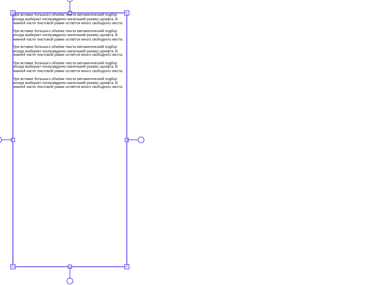
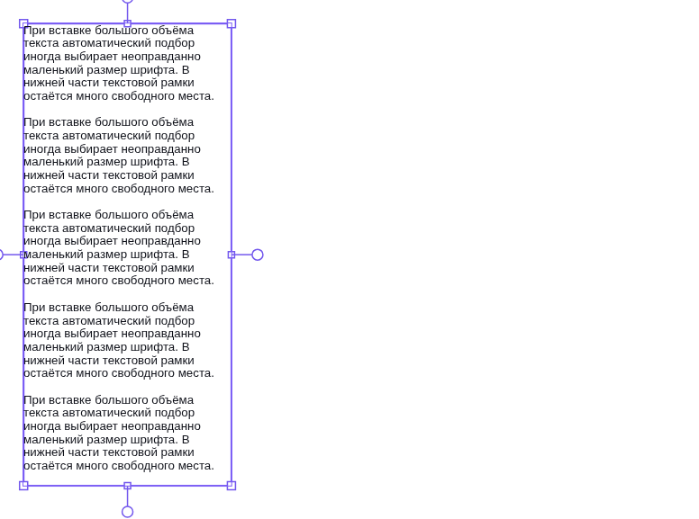
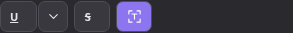

# T4.3. Автоподбор размера горизонтального текста

Базовый `origin/main` для [Issue #169](https://github.com/vadimkorsakov/kartochnaya/issues/169) — `c6b507edcb245eafb7e5e79c6eef2d5099f498c2`.

## Воспроизведение

Рамка 220 × 490 px, Arial 400, интерлиньяж 1,1, трекинг 0. Вставить пять копий абзаца, разделённых пустыми строками.

> При вставке большого объёма текста автоматический подбор иногда выбирает неоправданно маленький размер шрифта. В нижней части текстовой рамки остаётся много свободного места.

На исходном Chromium при 8 px самая широкая строка занимала 219,12 px, а её ширина без конечного обычного пробела была 216,90 px. Раскладка разрешала 220 px, проверка автоподбора пропускала до 219 px. На 9 px после смены раскладки ширина уменьшилась до 197,02 px, а 12 px давали блок высотой 476 px. Двоичный поиск на исходном коде отверг 8 px и вернул 7 px.

В рамке 180 × 350 px набор «Тест автоматического подбора размера текста.» приводил к fallback по графемам: строкам «автомат» и «ического». Движок добавлял разделители как отдельные токены до проверки следующего слова, поэтому часть U+0020 начинала новые строки. Для этого примера отступ был виден на трёх строках.

| Сценарий в Chromium | Размер, px | Высота блока, px | Высота рамки, px | Строки | Ограничение |
| --- | ---: | ---: | ---: | ---: | --- |
| Длинный, до | 7 | 146,3 | 490 | 19 | Ложный отказ на 8 px |
| Длинный, после | 12,7 | 476 | 490 | 34 | Высота при следующем размере |
| Короткий, до | 42 | 282 | 350 | 6 | Старый перенос по графемам |
| Короткий, после | 23,1 | 104 | 350 | 4 | Ширина слова «автоматического» |

На 12,8 px длинный блок достигает 510 px при тех же 34 строках. На 23,2 px слово «автоматического» занимает 180,57 px при рамке шириной 180 px.

## Контракт раскладки

- Политика целых слов действует для `autoFontSize: true` в общем горизонтальном движке. Пунктуация, дефисы, URL, U+00A0, U+202F и другие неразрывные последовательности остаются внутри токена. Границы `textRuns` влияют на метрики и отрисовку, графемы сохраняют целостность, а преобразования T3 учитываются в полной отображаемой длине.
- Пробелы U+0020 откладываются до следующего токена. На soft wrap предыдущая строка владеет их исходным диапазоном `hiddenSeparator`. Его визуальный advance равен нулю. Раскладка исключает этот диапазон из глифов, высоты, декораций и Justify. Отступы в начале абзаца, внутренние и явные конечные пробелы, табуляция, hard LF и пустые строки сохраняют свою геометрию. Исходный текст и форматирование остаются в модели.
- Canvas, PNG и desktop WYSIWYG получают общие позиции. WYSIWYG хранит скрытые пробелы в обычном текстовом узле, который участвует в UTF‑16 mapping и нативном Range. Для копирования берётся исходный диапазон. Caret affinity отмечает принадлежность границы предшествующей строке. Табуляция получает advance общей раскладки.
- Ширина рамки едина для переноса и проверки. Для списков доступная ширина текста учитывает маркер, общую колонку нумерации, отступ и зазор. Проверка высоты использует реальные baseline, ascent/descent, `lineHeight`, сдвиги, размер маркера и промежутки между пунктами. Границы глифов учитываются отдельно от логического advance. Justify расходует только доступное после учёта глифов место. Обводка и декорации используют собственный контракт отрисовки.
- Если 1 px не помещается, остаётся размер 1 px. Неразрывный токен сохраняется целиком в логической строке, а Canvas/PNG ограничивают видимую область рамкой. Для сохранённого ранее авторазмера с переполнением вычисляется размер для отображения. Первое действие, требующее пересчёта, сохраняет новый размер обычным путём. Документ, открытый для просмотра, сохраняет исходный размер в IndexedDB.
- Политика переноса входит в ключ кеша. Ручной размер, старые слои без флага и специализированные режимы сохраняют прежние правила. Фолбэк на desktop и Android использует нативный `textarea` и CSS-перенос. Он сохраняет полный исходный текст и собственную каретку. Canvas и PNG используют общий layout и при работе с `textarea`.

## Поиск

Кандидаты лежат на сетке 0,1 px в пределах 1–500 px. Верхняя граница ограничивается необходимым интерлиньяжем явных строк. Смешанные размеры и интервалы оцениваются по ведущим графемам и обязательным baseline-интервалам абзацев. Для размера-кандидата общий движок строит строки и проверяет ширину, высоту и глифы. Мерительный проход прекращается при доказанном переполнении завершённой строки и пропускает построение декораций. Относительный масштаб `textRunsBaseFontSize` сохраняется между пробами, правками и Undo/Redo.

Двоичное уточнение находит рабочую границу. Для смешанных диапазонов, списков и отрицательного трекинга выполняется до восьми дополнительных проб выше границы с уточнением вокруг найденной допустимой точки. Проверяются также следующие восемь десятых. Причины такого поиска — перестановка строк с разной высотой и дискретизация метрик браузера на соседних размерах. При неблагоприятном сочетании метрик узкая удалённая область допустимых размеров может оказаться между пробами. Итоговое значение всегда проходит проверку общей раскладкой, за исключением описанного аварийного размера 1 px. Перебор всей сетки выполняется только в контрольных тестах.

В контрольном примере со смешанным интерлиньяжем размер 15,7 px даёт 157 px высоты, а 15,8 px дают 115,34 px: два слова с увеличенным интерлиньяжем попадают на одну строку. При высоте рамки 130 px поиск и полный перебор дают 17,8 px.

## Замеры и проверки

В Chromium 156.0.8078.79 замерялось синхронное время обработки вставки 878 UTF‑16 единиц и последующих одиночных вводов с пересчётом и перепроецированием. Три свежие сессии на версию, пять вводов в каждой. Медиана вставки снизилась с 93,3 до 44,0 мс, медиана ввода — с 62,2 до 19,4 мс.

- Chromium 156.0.8078.79: 26 адресных сценариев, включая нативную каретку, список, шрифты, обратную подгонку рамки, `textarea`, мобильный режим, Canvas/PNG и проверку soft wraps.
- Firefox 157.0: 13 адресных сценариев, включая нативное выделение, вставку, T3, список и сравнение с перебором. Для последовательного кириллического ввода Playwright в Gecko использовался обычный `beforeinput`, поскольку его Unicode-клавиатура запускает IME. Латинский ввод, навигация и клавиатурное переключение проверены клавишами браузера.
- Пять рамок с реальными Canvas-метриками совпали с перебором на сетке 0,1 px в обоих браузерах. Синтетические метрики отдельно проверяют смешанные списки и немонотонную высоту.
- Расширенная диагностика `tests/text-layout.spec.js` в Firefox обнаружила расхождение инструментального `measureText().width` для эмодзи между экранным и экспортным контекстами. Два исходных сценария с трекингом 0 воспроизводят это на `c6b507e`. Те же сценарии в штатном проекте Chromium прошли с действующими точными проверками.
- `test:unit` — 674, `test:source` — 17, `build`, `build:verify` и `git diff --check` прошли. Проверка исходников подтвердила контрольные суммы исторических PNG.

## Файлы

- `src/render/rich-text-layout.mjs` — поиск, токены, метрики, списки и Justify.
- `src/editor/wysiwyg-session.mjs` — DOM-проекция, табуляция, caret affinity и синхронизация при форматировании.
- `src/editor.js`, `src/styles/legacy-01.css`, `src/styles/legacy-02.css` — вызовы пересчёта, совместимость старых авторамок, компактный переключатель и типографика.
- `tests/rich-text-layout.test.mjs`, `tests/text-autofit.spec.js`, `tests/text-layout.spec.js`, `tests/justify-painter.spec.js` — регрессии, исходные диапазоны, проверка рендера и контрольный перебор.
- `docs/text-autofit-t43.md`, `docs/screenshots/text-autofit-t43/` — отчёт и снимки.

## Ручная приёмка

1. Создать рамку и последовательно набрать «Тест автоматического подбора размера текста.», затем с новой строки «Список:» и три строки «Пункт 1», «Пункт 2», «Пункт 3». Выделить пункты, применить нумерацию, изменить размер маркера и интервалы между пунктами.
2. При открытых настройках списка выделить текст справа налево, переключить авторазмер мышью и клавишей Space, вернуться к вводу и проверить выделение. Ввести ручной размер и проверить Undo/Redo.
3. Вставить длинный пример в рамки разной ширины и высоты. Проверить полные слова, отступ после Enter, пустую строку и отсутствие отступа после soft wrap. Пройти границу клавишами Home/End и стрелками, проверить Backspace, Delete и копирование.
4. Повторить с NBSP, табуляцией, отформатированным словом, T3-расширением и составным эмодзи. Сравнить редактирование, Canvas и PNG после сохранения и повторного открытия.
5. Открыть «Мои шрифты», установить начертание и применить его к авторамке. Проверить тот же слой с изменёнными трекингом и интерлиньяжем.
6. На Android проверить существующий переключатель, редактирование через штатный IME и экспорт PNG. На desktop отдельно проверить установленную системную IME и восстановление неподтверждённого ввода.
