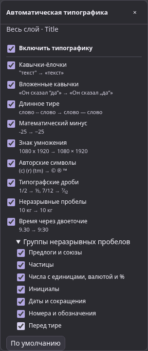

# T5. Автоматическая типографика слоя

В инспекторе горизонтального текста кнопка с угловыми кавычками находится сразу справа от автоподбора размера. Фиолетовая кнопка показывает, что у слоя включены правила. Подсказка показывает их количество.

Настройки относятся ко всему выбранному слою. Открытие и закрытие панели не меняют документ. Панель остаётся открытой при перемещении каретки, входе и выходе из редактирования и внешних кликах. Она показывает текущий слой. При множественном выборе, блокировке, неподходящем режиме или восстановлении ввода настройки недоступны. Панель закрывается через × или Escape.

Старые и новые слои без поля `typography` начинают с выключенной типографикой. Рекомендуемый набор включает внешние и вложенные кавычки, тире, минус и семь групп неразрывных пробелов. Умножение, авторские символы, дроби и время включаются отдельно. Общий переключатель запоминает набор из девяти правил. «По умолчанию» восстанавливает рекомендуемые правила и группы при текущем положении общего переключателя.

## Правила и границы

| Правило | Пример | Границы |
| --- | --- | --- |
| Кавычки-ёлочки | `"слово"` → `«слово»`, `“слово”` → `«слово»` | Обрабатывает найденные пары на одной строке. Одиночная кавычка и метка `5"` сохраняются. |
| Вложенные кавычки | `«Он сказал “да”»` → `«Он сказал „да“»` | Меняет второй уровень внутри распознанной внешней пары. Если внутри вложенной пары есть ещё один уровень, этот фрагмент сохраняется. При выключенных ёлочках внешняя пара сохраняет исходный стиль. |
| Длинное тире | `слово -- слово` → `слово — слово` | Требует пробелов с двух сторон дефиса или двойного дефиса. Пробелы сохраняются, если их отдельно не меняет правило неразрывных пробелов. Слова с дефисом и распознанные числовые диапазоны сохраняются. |
| Математический минус | `-25 °C` → `−25 °C` | Меняет унарный дефис перед цифрой в ясном контексте. Вычитание, диапазоны, даты, телефоны, идентификаторы и распознанные аргументы CLI сохраняются. |
| Знак умножения | `1080 x 1920`, `1080 х 1920`, `3 * 4` → `1080 × 1920`, `1080 × 1920`, `3 × 4` | Между числами требуются обычные пробелы с обеих сторон. Буквенные переменные, `3*4`, версии, SKU и шестнадцатеричные токены сохраняются. |
| Авторские символы | `(c) (R) (tm)` → `© ® ™` | Отдельные токены, с любым регистром букв. Например, `fn(c)`, адрес почты и запись внутри обратных кавычек сохраняются. |
| Типографские дроби | `1/2` → `½`, `7/12` → `⁷⁄₁₂`, `125/256` → `¹²⁵⁄₂₅₆` | Отдельные целые числа из цифр 0–9 по обе стороны черты. Знаменатель должен быть положительным. Запись цифр сохраняется, включая ведущие нули. Отдельная дата без года вроде `24/11` трактуется как дробь. |
| Неразрывные пробелы | `10 кг` → `10 кг` | Заменяет одиночный существующий U+0020. Сохраняет табуляцию, переносы строк, двойные и более длинные пробелы, U+00A0 и U+202F. |
| Время через двоеточие | `9.30` → `9:30`, `09.00–18.00` → `09:00–18:00` | Часы 0–23 из одной или двух цифр, минуты 00–59 из двух цифр. Сохраняет ведущие нули и оформление диапазона. Отдельное число вроде `3.14` трактуется как время. |

Дроби используют готовые символы Unicode для точных записей, например `2/3 → ⅔` и `5/8 → ⅝`. Остальные отображаются надстрочными и подстрочными цифрами с дробной чертой U+2044. Если в выбранном шрифте отсутствуют эти символы, браузер подбирает запасные глифы. От выбранного шрифта и системы зависят форма и ширина дроби.

Правило дробей сохраняет запись после математического знака, в том числе через обычный или неразрывный пробел. Оно также распознаёт очевидные выражения вроде `1/2 + 3/4` и числовой контекст `2 x 7/12`. Эвристика рассчитана на распространённые операции. Даты с годом, дроби с целой частью вроде `1 1/2`, цепочки с несколькими чертами и обозначения разделов сохраняются.

Правило времени сохраняет полные даты, версии, IP-адреса, явные технические идентификаторы, числа со знаком и записи с распознанными единицами, валютой или процентом. В диапазонах оно меняет только две точки. Остальные правила продолжают использовать обычную защиту числовых диапазонов.

Группы пробелов настраиваются независимо.

- Предлоги и союзы — `в доме`, `и дальше`.
- Частицы — `сделал бы`, `помнишь ли`.
- Числа с единицами, валютой и процентом — `10 кг`, `20 %`, `7 ₽`.
- Инициалы — `А. С. Пушкин`.
- Даты и сокращения — `24 ноября`, `2026 г.`, `т. д.`, `т. п.`.
- Номера и обозначения — `№ 7`, `§ 3`, `ул. Мира`.
- Перед тире — `слово — пояснение`. Работает и перед тире, полученным из дефисов в этой же проекции.

Словари рассчитаны на распространённые русские конструкции. Подряд создаётся до двух склеек для коротких слов и частиц. URL, адреса почты, пути, даты, версии, телефоны, технические идентификаторы и код защищаются по распознаваемым формам исходного текста. Для произвольного кода используйте обратные кавычки. Распознавание свободного технического текста эвристическое.

## Как хранится и отображается текст

`element.text`, `textRuns` и `paragraphRuns` содержат исходный текст и смещения UTF-16. Технические фрагменты и совпадения правил распознаются в исходном тексте. Изменение регистра T3 тоже вычисляется от исходного текста и заполняет интервалы, которые типографика оставила нетронутыми. Интервалы проекции по порядку покрывают исходную и отображаемую строки, включая сокращения вроде `(tm) → ™` и расширения вроде `ß → SS`. Если сокращение пересекает несовместимые стили или пытается поглотить часть графемы, оно пропускается. Маркеры и нумерация списка остаются отдельными от текста.

Canvas, экспорт PNG и desktop WYSIWYG используют общие строки layout. Проекция кэшируется по исходнику, настройкам и границам стилей, а автоподбор использует одну проекцию для пробных размеров с шагом 0,1 px. Связка с неразрывным пробелом остаётся одним фрагментом для переноса даже в ручном размере. Если связка шире рамки, её края обрезаются границами отрисовки. При смене правил сохраняется записанный размер шрифта, чтобы прежний вид восстанавливался при отключении. В режиме автоподбора отображаемый размер при необходимости уменьшается до 1 px. Justify растягивает только обычные пробелы. На мягком переносе скрываются только обычные разделительные пробелы по правилам T4.3.

Каретка и выделение принадлежат нативному DOM. У сокращений и типографских дробей доступны две границы. Составная дробь остаётся целой при переносе, в том числе если её длина UTF-16 совпадает с исходной. Backspace и Delete удаляют весь соответствующий интервал исходника. Если включение правила поглощает конец выделения, выделение охватывает весь видимый интервал и сохраняет направление. Copy и Cut возвращают исходные символы, включая обычные пробелы и последовательности вроде `7/12` и `9.30`. Вставка изменяет исходник, после чего отображение вычисляется заново. Неподтверждённый ввод IME остаётся в существующем режиме восстановления до явного действия.

Настройки сохраняются в JSON, проектах, дубликатах и ZIP с прежней схемой IndexedDB v3. Дроби используют прежний ключ `fractions`. В старых настройках без `timeColon` правило времени выключено. При импорте документа или копии проекта проверяются типы полей, а неизвестные ключи отбрасываются. Прямое восстановление рабочего пространства сохраняет записи архива без нормализации по существующему контракту. Некорректная конфигурация в такой записи не участвует в отображении. Вертикальный текст, текст по контуру и дуге сохраняют настройки до возврата в горизонтальный режим. На мобильном Canvas и в PNG работает общая проекция. Нативное поле на Android и desktop textarea при fallback показывают исходный текст.

## Ручная приёмка

- Windows, Chromium и Firefox. Открыть старый документ с `9.30` и проверить прежнее отображение времени. Выбрать один слой, открыть панель и проверить историю. Включить общий переключатель, затем четыре дополнительных правила. Проверить, что подсказка показывает девять активных правил, и сравнить примеры из таблицы и технические исключения.
- Ввести `"Он сказал “да”" -- -25 °C; 1080 х 1920; (tm); 1/2; в доме.` и добавить отдельную строку `Straße` с верхним регистром. Применить цвет, подчёркивание, обводку и надстрочный сдвиг к разным участкам. Провести границу стилей внутри `1/2` и убедиться, что дробь сохраняет исходные символы.
- Щёлкнуть и протянуть выделение справа налево через `½`, `¹²⁵⁄₂₅₆`, `™` и `SS`. Проверить Home/End и стрелки на мягких переносах, выделение при смене правил, Backspace/Delete и один Undo/Redo. Проверить видимость надстрочных и подстрочных цифр в стандартных шрифтах и содержимое системного буфера через вставку в обычный текстовый редактор.
- Сузить рамку, чтобы перенос потребовался рядом с `10 кг`. Сравнить ручной размер и автоподбор, Justify и список с пользовательским маркером. Сравнить Canvas, WYSIWYG и выгруженный PNG.
- С открытой панелью войти в редактирование, перенести каретку, выйти, выбрать другой слой и заблокировать его. Проверить × и Escape. Открыть настройки списка и подчёркивания и проверить их обычные действия.
- Включить системный Windows IME, например японский или китайский, и начать композицию. Проверить блокировку панели, возможность скопировать неподтверждённый ввод и восстановить подтверждённый текст. При поддерживаемом вводе повторить набор с реальной клавиатуры.
- Дублировать слой, сохранить и перезагрузить документ. Экспортировать документ в JSON, затем сделать ZIP и импортировать копию проекта. Сравнить настройки и исходный текст у оригинала и копий.
- Android с родной клавиатурой. Открыть тот же документ, сравнить Canvas и PNG с десктопом, изменить исходник в textarea, завершить ввод и проверить восстановление проекции. Проверить композицию системной клавиатуры и возврат из неё.
