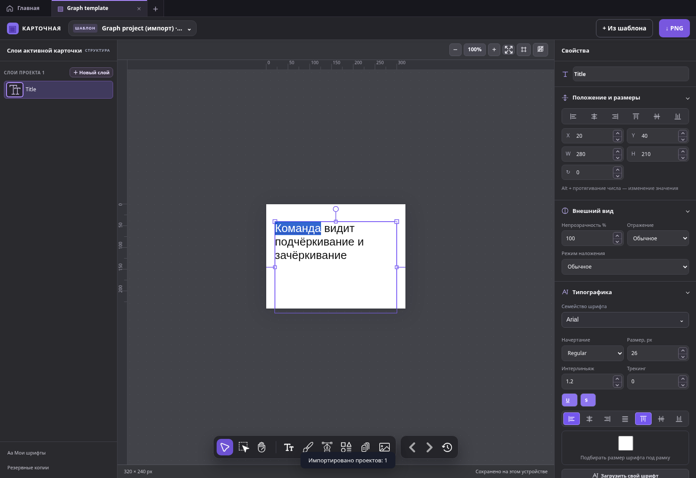
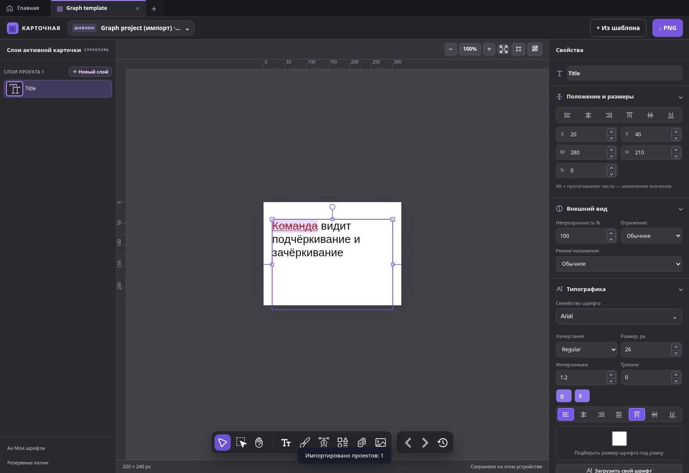

# WYSIWYG: выделение и стоимость палитры — Issue #148

Работа в существующем [PR #147](https://github.com/vadimkorsakov/kartochnaya/pull/147),
фактическая ветка `fix/146-justify-wysiwyg-default`, исходный HEAD `cecc9f1`.
Связано с [Issue #148](https://github.com/vadimkorsakov/kartochnaya/issues/148).
Merge и production deploy не выполняются; требуется повторная приёмка Windows Firefox.
Видео, упомянутое в Issue, не приложено к этому сеансу и не загружено в GitHub.
Причина задержек установлена измерениями приложения, а не интерпретацией видео.

## Выделение

У обычного `.inline-wysiwyg` отсутствовало собственное `::selection`.
Нативная непрозрачная синяя подсветка меняла цвет выбранных букв и закрывала
декорации, которые редактор уже рисует фоном строки. Правило было только у
`.wysiwyg-canvas-ink`.

Исправление ограничено редактором: `rgba(128,98,247,.20)`, явный живой цвет
фрагмента через `--wysiwyg-ink`, прозрачный DOM-текст в существующем canvas-ink.
Подчёркивание/зачёркивание и сам диапазон видны одновременно. Общего правила
`::selection` для приложения нет. Новый renderer выделения не добавлен.

Проверены CSS-варианты: на локальном Chromium после живой смены цвета
`currentColor` и `inherit` могли оставлять у highlight прежний computed color;
переменная originating fragment устраняет это. Это не утверждение о причине
поведения Windows Firefox; его результат проверяется отдельным CI и вручную.

Снимки одного и того же документа с нативным обратным выделением `[7,0]`,
цветом, underline и strikethrough (реальные сборки до/после):

| До: PR #147 `cecc9f1` | После |
| --- | --- |
|  |  |

E2E проверяют все четыре выравнивания, plain/rich, выбранное слово,
многострочный и обратный диапазон, видимые пиксели обеих декораций при активном
Selection, цвет после HEX, каретку/ввод, canvas-ink и светлый текст на тёмном
документе. Вход в WYSIWYG создаёт каретку в конце, а не select-all; реальный
диапазон после выбора и форматирования сохраняется. Selection API, UTF-16
mapping, textRuns и pointer adapter не изменены.

## Воспроизводимый замер

`tests/wysiwyg-performance.spec.js` импортирует реальный документ: 1203 UTF-16
символа, пять русских абзацев, три sparse textRuns, рамка 600×1100, Arial 20,
Justify, strokeWidth=1, zoom 80%, обратное выделение слова «Команда».
После открытия заливки выполняются 6 HEX input, 50 Hue input с промежуточным
кадром, 10 Alpha input, 6 последовательных цветов, change/finalization,
настоящий pointer-жест в saturation/value square (12 шагов), закрытие палитры,
underline/strikethrough. Получаются 72 input, 18 pointer events, 94 измеренных
события с change. Для равного числа действий input/change отправляются через
DOM Event; pointer-жест доверенный. Отдельные прежние E2E проверяют реальные
клавиши, HEX/RGB, sliders и presets.

Один harness собирает неизменённые исходники:

- PR #144 `a07c1a6` с `?experimentalJustifyWysiwyg=1`;
- PR #147 `cecc9f1` без флагов;
- исправленную сборку без флагов;
- ту же исправленную сборку с `?experimentalTextWysiwyg=0`.

Инструментация внедряется только тестом в собранный HTML и остаётся в `tests/`.
Она считает и измеряет inclusive CPU через `performance.now()`, реальное
создание baseline-проб, замены DOM, paint и события. Вложенные времена нельзя
складывать. Измерения не добавляют production-API или диагностический флаг.
В CI сохраняются JSON, screenshots и Playwright traces обоих браузеров.

Повторить после `npm ci && npm run build`:

```sh
# При shallow checkout сначала получить два фиксированных comparison commit.
git fetch --no-tags origin a07c1a60cca9d53a1a199c1572000f4395b86942 cecc9f16aca98471aa90e580a018f3912f27142a
PLAYWRIGHT_CHROMIUM_EXECUTABLE_PATH=/usr/bin/chromium npx playwright test --config=playwright.wysiwyg-ux.config.js --project=ux-chromium
# Firefox выполняется тем же config в Actions; локально он не установлен.
```

## Локальный Linux Chromium 154.0.8037.57

Playwright 1.64.1, один worker, одинаковый документ и последовательность,
tracing включён во всех сравнениях. Данные последнего сопоставимого прогона:
[chromium-profile.json](assets/wysiwyg-148/chromium-profile.json).

| Сборка | Input p50 / p95 / max, мс | CPU 72 input, мс | Pointer p50 / p95 / max, мс | Следующий rAF p50 / p95, мс |
| --- | ---: | ---: | ---: | ---: |
| #144, Justify=1 | 114.1 / 160.2 / 181.6 | 8078.0 | 113.7 / 148.6 / 148.6 | 124.2 / 180.6 |
| #147, без флагов, до | 109.8 / 148.7 / 177.4 | 7853.1 | 110.9 / 149.4 / 149.4 | 119.2 / 174.0 |
| После, без флагов | 47.5 / 72.7 / 78.1 | 3458.5 | 43.9 / 91.0 / 91.0 | 55.1 / 91.2 |
| Text=0, контроль | 1.0 / 1.7 / 1.9 | 65.7 | 1.1 / 23.6 / 23.6 | 16.1 / 24.5 |

Text=0 сохраняет прежний отказ форматировать выделенный Justify-диапазон;
он не выполняет эквивалентный live preview. Его скорость нельзя считать
скоростью альтернативного полноценного WYSIWYG.
Следующий rAF — возможность кадра, а не точное время физического отображения
нового цвета. Отдельный тест подтверждает более 20 разных промежуточных ink
состояний за 50 Hue input до завершающего change. Сквозная задержка до дисплея
Windows здесь не измерена.

| Работа за тот же сценарий | #144 | #147 до | После |
| --- | ---: | ---: | ---: |
| project() | 88 | 88 | 88 |
| replaceChildren() редактора | 88 | 88 | 88 |
| layout() / layoutJustified() | 440 / 440 | 440 / 440 | 440 / 440 |
| baseline helper calls | 33088 | 33088 | 33088 |
| реальные DOM baseline-пробы | 33088 | 33088 | 0 |
| getBoundingClientRect(), весь сценарий | 66628 | 66628 | 452 |
| measureText() | 33704 | 33704 | 33704 |
| lineHeight() | 616 | 616 | 616 |
| syncOverlay() | 176 | 176 | 176 |
| ink passes (fill + stroke, существующий Canvas) | 166 | 166 | 166 |
| paint() основного документа | 91 | 91 | 91 |
| refreshPickerVisual() | 162 | 162 | 87 |
| baseline helper CPU, мс | 5099.5 | 5048.3 | 57.7 |
| project CPU, мс | 8023.5 | 7973.3 | 2182.1 |
| layoutJustified CPU, мс | 2123.5 | 2078.2 | 2048.1 |
| lineHeight CPU, мс | 6.5 | 6.1 | 5.8 |
| measureText CPU, мс | 91.1 | 83.6 | 40.8 |
| refreshPickerVisual CPU, мс | 168.0 | 144.5 | 91.8 |
| long tasks, число / сумма мс / max мс | 85 / 11067 / 247 | 85 / 10889 / 276 | 57 / 3674 / 128 |

Кэш уже прогрет входом в редактирование до окна замера; «0» не означает,
что первичная проекция вообще не измеряет шрифты. Исходные PR #144/#147
выполняют одинаковую работу. Воспроизведён дорогой существующий путь,
а не доказано удорожание вычислений из-за включения Justify по умолчанию.

Подтверждённое узкое место: `project()` на каждом preview снова создавал
и присоединял probe для каждого фрагмента, затем синхронно читал геометрию
и удалял probe. На baseline уходило около 5 секунд из 8 секунд project CPU.
Повторный refresh палитры тоже подтверждён, но его стоимость значительно ниже.

## Ограниченное исправление

- Кэш baseline offsets на время сессии, максимум 512 записей. Ключ включает
  фактический CSS font, letterSpacing, высоту строки, baseline и текст пробы
  (включая зависимость от fallback glyphs). FontFaceSet loadingdone/loadingerror
  очищают кэш; listeners принадлежат существующему AbortController.
- Меняется цвет/alpha при тех же метриках — DOM-проба переиспользуется.
  Новые fontSize/font/letterSpacing/lineHeight/строки получают другой ключ.
  Общая layout/projection ветка, strokeWidth и изменение ширины сохраняют
  прежние перерасчёты. Не вводится общий кэш геометрии всего слоя.
- Убрано повторное `refreshPickerVisual(false)` из range-ветки updatePickerColor:
  cpLiveColor и завершающие обработчики уже обновляют UI.
- Нет rAF-очереди или отложенной записи модели. Все промежуточные значения
  применяются синхронно; порядок finalization, история и сохранение прежние.

Input CPU уменьшился на 56%, p95 — на 51%, project CPU — на 73% в этом прогоне.
Это не устранение всех долгих задач: сохраняются 88 перестроений DOM,
440 layout-вызовов и 57 long tasks. Полное устранение пользовательской
«вязкости» не заявляется. Продолжение оптимизации зависит от ручной приёмки,
а не только от зелёного CI.

## Проверки и ограничения

Локально: 19 адресных UX/performance E2E Chromium (частями после изменений
harness), затем финальные четыре сопоставимых профиля; 11 прежних регрессий
range styles/auto-fit/Mixed/cancellation/Unicode/пробелы/реальная палитра и
Undo/Redo; 615 unit; 17 source; build и build:verify. Проверки light/dark,
continuous Hue final value/один Undo/Redo, zoom/закрытие и инвалидирование
baseline после metric/font lifecycle изменений прошли.

В 10 локальных parity-сравнениях из этих 11 прежних тестов:
**Canvas↔PNG max delta 0; live ink↔PNG max delta 2**, пороги ≤1/≤2 и эталоны
не изменены. Финальные результаты всей матрицы, Firefox и ссылки на артефакты
публикуются в PR #147 после Actions; старые suite остаются в workflow.

Локальная попытка запуска Firefox: executable отсутствует
(`firefox-1555/firefox/firefox`). Браузер не устанавливался повторно, TLS не
отключался. Firefox selection/performance/parity и полный регресс запускает
существующий Actions workflow вместе с новым `wysiwyg-ux-measurements` artifact.
Firefox может не поддерживать Long Tasks API; JSON отмечает поддержку явно,
а задержки обработчиков всё равно измеряются.

Preview для повторной приёмки: https://deploy-preview-147--kartochnaya.netlify.app/
(без флагов; конкретный новый deploy подтверждается в PR).

Остаётся Windows Firefox: аппаратное прямое/обратное и многострочное выделение,
видимость underline/strike и цвета на целевой теме, непрерывный Hue/Alpha,
быстрое закрытие/смена фокуса/слоя, субъективная плавность на исходном документе,
реальная кириллица/OS IME и hardware mouse jitter. Linux/Playwright не заменяет
эту проверку. PR остаётся открытым до пользовательской приёмки.
